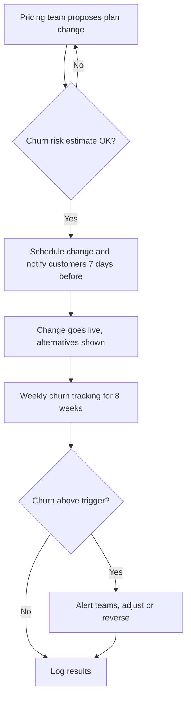

# 05. Proposed To-Be Process and Process Flow

## To-Be process
1. Pricing team proposes a plan change.
2. System estimates churn risk by segment (FR1). If risk is above the limit, the proposal goes back for redesign.
3. Approved change is scheduled and affected customers get advance notice with options (FR2).
4. Change goes live and the recharge screen suggests alternatives (FR5).
5. Weekly churn dashboard tracks affected segments (FR3, FR4).
6. If churn crosses the trigger, an alert goes out (FR6) and the team adjusts or reverses the change.
7. Results are logged for the next decision.

## Process flow

Thresholds (7 days, 8 weeks, 0.2 points) are illustrative and need validation with stakeholders.
