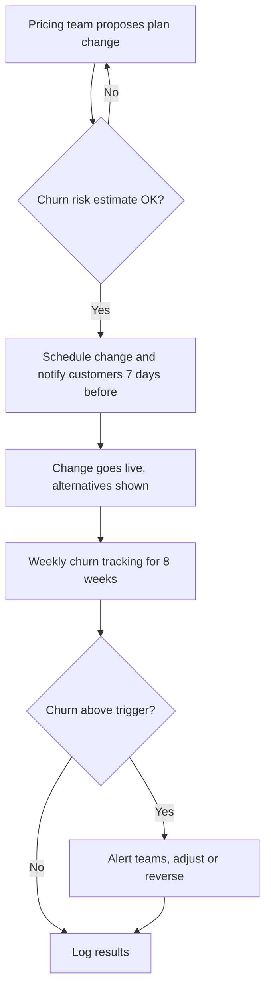

# Airtel Prepaid Customer Retention: Business Analysis Case Study

**Day 1 of a 15-day Business Analysis Case Study Challenge** | Author: Khushi Singh
[LinkedIn post](https://www.linkedin.com/feed/update/urn:li:activity:7530957713451667456/) | [LinkedIn profile](https://www.linkedin.com/in/khushi-singh-95017427a/)

An independent learning project built from public information only. Not affiliated with or endorsed by Airtel. Figures come from news coverage and broker research ([SOURCES.md](SOURCES.md)); internal processes and systems are assumptions and are marked as such.

## The business problem
In August 2026 Airtel withdrew its Rs 299 prepaid plan to lift ARPU. Reported churn rose from 2.6% to 2.9% and net subscriber additions fell from 3.3 million to 0.7 million. Analysts linked this to the change (a hypothesis, not confirmed by Airtel). The plan was restored in November.

**BA question:** how could Airtel estimate, warn about and monitor churn risk from a plan change, and respond quickly if customers start leaving?

**Takeaway:** raising ARPU is only a win if you know who you will lose.

## Repository contents
| File | BA step |
|---|---|
| [01_context_and_problem.md](01_context_and_problem.md) | 1. Company context, 2. Problem identification |
| [02_stakeholders_and_questions.md](02_stakeholders_and_questions.md) | 3. Stakeholders, 4. Elicitation questions |
| [03_as_is_and_gap_analysis.md](03_as_is_and_gap_analysis.md) | 5. As-Is process, 6. Root cause and gaps |
| [04_BRD.md](04_BRD.md) | 7. BRD / FRD |
| [05_to_be_process_and_flow.md](05_to_be_process_and_flow.md) | 8. To-Be process and flow |
| [06_user_stories.md](06_user_stories.md) | 9. User stories and acceptance criteria |
| [07_business_rules.md](07_business_rules.md) | 10. Business rules |
| [08_UAT_Scenarios.md](08_UAT_Scenarios.md) | 11. UAT scenarios |
| [09_traceability_matrix.md](09_traceability_matrix.md) | Requirement to test traceability |
| [carousel/](carousel/) | LinkedIn carousel (PDF) |
| [SOURCES.md](SOURCES.md) | Source list |

## Key requirements
| ID | Requirement |
|---|---|
| BR1 | Estimate churn risk by segment before any plan is withdrawn or repriced |
| BR2 | Notify affected customers in advance with options |
| BR3 | Track churn weekly for affected segments after a change |
| BR4 | Offer a suitable alternative plan to low-usage customers |
| BR5 | Trigger a review or reversal when churn crosses a set limit |

## Process flow

## Limitations
- Notice periods, churn limits and review windows are illustrative and need validation with stakeholders and data.
- The As-Is process is partly assumed because Airtel's internal process is not public.
- Whether the plan withdrawal caused the churn rise is an analyst view, not confirmed by the company.

## Skills demonstrated
Problem framing, stakeholder analysis, requirements elicitation, As-Is and To-Be analysis, root-cause and gap analysis, BRD/FRD writing, user stories with acceptance criteria, business rules, process flow, UAT design, traceability.
